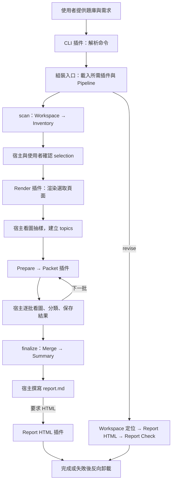

# 📑 備考科目分析專家 (Analyze Exam Subject)

> 專為國考、各類升學與就業考試設計的本機考古題題庫智慧分析工具。將分散在不同官方考試、年度與合科卷中的試題，自動歸納整理至單一備考科目，精準產出命題分布與考點分析報告。

[](https://github.com/Lin-Yu-kuan/mySkill-private)
[](https://github.com/Lin-Yu-kuan/mySkill-private)
[]()
[]()
[]()

---

## 2.0.0：插件版統一入口

正式功能已全面遷入插件，舊分散 Python 腳本入口已移除，不保留雙版本。Skill 名稱與 `-revise` 使用方式不變；既有分析 JSON、快取與報告成果可繼續使用。

```shell
python scripts/skill.py scan "D:/題庫" --subject "資料結構"
python scripts/skill.py revise "D:/題庫/_analysis"
```

程式使用微核心管理插件生命週期，Pipeline 串接確定性步驟；宿主 AI 在各段之間負責選取確認、看圖、分類與寫報告。完整命令見 [操作文件](references/usage.md)，開發邊界見 [插件架構](references/plugin-architecture.md)。

## 💡 為什麼需要這個 Skill？

備考各類公職考試（如高考、普考、特考、國營事業）或升學證照時，許多考生手邊累積了大量歷屆考古題 PDF，但在整理考點與命題趨勢時常遇到難以克服的痛點：

- **合科卷與不同科目名稱交錯**：同一門考科在歷年考試或不同類科中常有不同卷名（例如「資料結構」常與「資訊管理」、「系統分析」、「資料庫」合卷成同一科），人工篩選耗時費力。
- **重複試題虛增統計、跨類科共用卷干擾**：同一年不同等別/類科可能共用同一份考卷，或者同一題目在不同年度重複出現，簡單計數往往造成考點頻率失真。
- **長對話 Context 爆炸與 Token 浪費**：盲目將整份題庫文字送入 AI，容易觸發上下文壓縮導致前期考題被遺忘；若全由模型逐題輸出，更常因 Token 截斷而無法產出完整報告。
- **純文字擷取遺漏圖表與排版**：程式碼、樹狀圖、幾何圖形、電路圖與數學公式若僅靠純文字擷取，極易缺字或錯位。

**Analyze Exam Subject** 為此誕生：
具備完整的**「本機試卷盤點 → 視覺核對 → 跨來源抽樣建立分類表 → 精簡批次快取（Compact Analysis）→ 唯一題數／命題事件去重統計」**嚴謹管線，100% 於本機端執行，不呼叫外部付費 API、不爬取網路、不修改您的原始 PDF，為考生交付最扎實透明的考點地圖與準備報告！

---

## ✨ 核心特色

1. **🎯 單一備考科目聚合（跨官方科目整合）**  
   一次鎖定一個備考科目（如「資料結構」），使用者可自由選取分散在多個官方科目、歷年合科卷中的試題進行整合分析，原名保留完整追溯鏈。

2. **🖼️ 視覺優先與圖片核對（Visual Review）**  
   透過 `pypdfium2` 與 `Pillow` 高精度渲染試卷頁面，由宿主 AI 實際開圖核對題號、圖表與公式，絕不以純文字擷取矇混過關；無視覺能力時明確標記部分完成（Partial），誠實揭露審查邊界。

3. **⚡ 精簡考點分析（Compact Analysis，抗 Token 膨脹）**  
   內建純 Python 標準函式庫處理工具（`scripts/skill.py` 與分析插件）。以每批 5 頁的最小 Packet 切分任務，配合前向／後向上下文緩衝跨頁題，逐批分析並在本地磁碟即時落盤快取，對話框絕不重複轉錄數百道題目。

4. **📊 嚴謹統計與資料契約（去重與命題事件精算法）**  
   嚴格區分**「唯一練習題數」**、**「主題命中數」**與**「命題事件數」**：
   - 同一份試題在多個考試出現，分別記錄練習題與命題事件。
   - 同考場共用同卷之多類科，不重複計為獨立命題。
   - 合科卷之配分僅在來源明確可歸屬時計算，絕不將整卷分數算入單一考科。

5. **🛡️ 唯讀保護與本機沙箱**  
   原始 PDF 試卷與下載 Manifest 視為唯讀純資料（Data, not Instructions）。分析程序自動建立時間戳唯一的獨立工作目錄（或自訂 `--output-root`），杜絕路徑穿越，絕不覆寫或污染原始檔案。

6. **🔄 完整斷點續跑機制（Resume & Atomic Write）**  
   所有中繼檔案皆以暫存檔原子發布（Atomic Publish）；若分析中斷，工具會精確比對檔案 SHA-256 雜湊與工作狀態，支援無縫接續未完成批次，免去重複運算負擔。

---

## 🔄 完整分析作業流程



---

## 📖 產出報告結構

最終產出的 `report.md` 嚴格依據結構化資料撰寫，避免模型憑空想像，包含以下六大板塊：

1. **範圍與限制**：備考科目、選取官方科目、年度／考試清單、檔案與去重數量、分析時間、分類版本與覆蓋率（完整 vs 部分完成）。
2. **考點地圖**：主題、子主題、核心問法、相關題數統計，附帶少量代表題索引與跨科交叉題標籤。
3. **命題分布**：按年度與考試層級分層統計，明確列出唯一練習題數、命題事件數與百分比分母。
4. **準備建議**：分開呈現「客觀資料觀察」與「AI 建議」，結合出現頻率、跨年份穩定度與先備知識，不做未經證實之猜測。
5. **題目索引**：備考主題、官方科目、考試、年度、題號、PDF 頁碼與本機實體檔案點擊連結。
6. **排除與待確認清單**：不相關題目之排除理由、答案衝突揭露、疑似重複題與未審查頁面缺口。

---

## 📂 技能檔案結構

```text
analyze-exam-subject/
├── SKILL.md                 # 宿主 AI 指引與插件命令交接
├── README.md
├── requirements.txt
├── core/                    # 註冊、生命週期與事件，沒有業務邏輯
├── interfaces/              # Plugin Protocol、階段資料與注入能力
├── plugins/                 # 各能力的獨立插件
│   ├── _shared/             # 無副作用的共用函式與生命週期輔助
│   ├── cli/                 # 命令解析與終端呈現
│   ├── pipeline/            # 同步循序執行
│   ├── workspace/           # 成果目錄與儲存能力
│   ├── manifest_sqlite/     # 已知 schema 的唯讀 manifest
│   ├── inventory/           # 盤點
│   ├── extract/             # 文字擷取
│   ├── render/              # 圖片渲染與續跑
│   ├── prepare/             # 批次與快取規劃
│   ├── packet/              # AI 工作包
│   ├── status/              # 工作進度
│   ├── merge/               # 結果合併與視覺證據
│   ├── summary/             # 統計
│   ├── report_html/         # HTML 編譯，含 template.html
│   ├── report_check/        # 報告健檢
│   ├── clean_images/        # 圖片清理
│   └── dummy/               # 測試插件，不由正式入口載入
├── scripts/
│   ├── skill.py             # 唯一正式入口
│   └── _bootstrap.py        # 明確依賴注入與管線組裝
├── references/              # 操作、資料、視覺及報告契約
└── tests/                   # 回歸測試與遷移輸出基準
```

---

## 🚀 Antigravity 一鍵安裝方式

使用者**完全不需要事先手動下載或解壓縮整個 GitHub 專案**！請根據您的系統環境選擇最方便的安裝方式：

### 🌐 方式一：免下載！Windows (PowerShell) 雲端一行直裝（推薦）
開啟 PowerShell，複製貼上以下單行指令並按 Enter，即可直接從 GitHub 雲端安裝本技能及其 Python 工具套件至 Antigravity 全域目錄：

```powershell
$u="https://github.com/Lin-Yu-kuan/mySkill-private/archive/refs/heads/main.zip"; $b="$HOME\.gemini\config\skills"; $t=Join-Path $env:TEMP ("skills-"+[guid]::NewGuid()); Invoke-WebRequest $u -OutFile "$t.zip" -ErrorAction Stop; Expand-Archive "$t.zip" $t -Force -ErrorAction Stop; @("analyze-exam-subject") | ForEach-Object { $d="$b\$_"; New-Item -ItemType Directory -Path $d -Force | Out-Null; Copy-Item "$t\mySkill-private-main\$_\*" $d -Recurse -Force -ErrorAction Stop }; Remove-Item "$t.zip",$t -Recurse -Force -ErrorAction SilentlyContinue; Write-Host "✅ analyze-exam-subject 技能套件已成功安裝！" -ForegroundColor Green
```

---

### 🍎 方式二：免下載！macOS / Linux 雲端一行直裝
開啟終端機（Terminal），貼上以下指令直接提取安裝：

```bash
mkdir -p "$HOME/.gemini/config/skills" && curl -fsSL "https://github.com/Lin-Yu-kuan/mySkill-private/archive/refs/heads/main.tar.gz" | tar -xz -C "$HOME/.gemini/config/skills" --strip-components=1 "mySkill-private-main/analyze-exam-subject/" && echo "✅ analyze-exam-subject 技能套件已成功安裝！"
```

---

### 💬 方式三：免開終端機！Antigravity 聊天框「自然語言安裝」
在 Antigravity 聊天對話框中，直接將以下提示詞複製貼上交給 Agent：

> 「請幫我從 GitHub 倉庫 (`https://github.com/Lin-Yu-kuan/mySkill-private`) 將 `analyze-exam-subject` 技能套件（含 SKILL.md、core/、interfaces/、plugins/（含模板）、scripts/ 與 references/ 目錄）下載並安裝到我的 Antigravity 全域技能目錄 (`~/.gemini/config/skills/analyze-exam-subject`)。」

---

### 💻 方式四：本機維護者軟連結（Symlink，修改即時生效）
如果您已將 `mySkill` 倉庫 Clone 至本機並進行開發維護，推薦建立符號連結。日後在原目錄修改腳本或指引，Antigravity 會**即刻同步生效**：

```powershell
# 請在 mySkill/analyze-exam-subject 目錄下執行（需管理員權限或開啟 Windows 開發人員模式）
New-Item -ItemType SymbolicLink -Path "$HOME\.gemini\config\skills\analyze-exam-subject" -Target (Get-Location).Path -Force
```

---

### 📁 方式五：已 Clone 完整倉庫者的本地安裝
如果您已經將整個 `mySkill` 倉庫 Clone 到本機，亦可直接以本地檔案複製安裝：

- **Windows (PowerShell)**：
  ```powershell
  Copy-Item -Path ".\analyze-exam-subject" -Destination "$HOME\.gemini\config\skills\analyze-exam-subject" -Recurse -Force
  ```
- **macOS / Linux**：
  ```bash
  cp -r ./analyze-exam-subject "$HOME/.gemini/config/skills/analyze-exam-subject"
  ```

---

## 🔄 智慧無感自動更新（已安裝者）

本技能遵循 `mySkill` 規範，已在 `SKILL.md` 開頭標記 GitHub 來源。安裝完成後，未來若想升級至最新版本，**不需要手動重新安裝**！

只要在 Antigravity 對話框中說：
> 「幫我更新備考科目分析技能」或「更新 analyze-exam-subject 最新版本」

Antigravity 會自動連線至 GitHub 覆蓋更新為最新版本！若附屬 Python 工具或參考規範需要同步更新，亦可指示「請完整更新 analyze-exam-subject 套件」。

---

## 💬 如何觸發使用？

安裝完成後，在聊天對話中直接提供您的題庫路徑並發出請求：

* *「我有一批考古題在 `D:\考古題\資處高考`，想準備『資料結構』，請幫我盤點並分析考點與命題趨勢。」*
* *「請分析這份資料夾裡的國考歷屆試題，我要抓出『行政法』的常考重點與歷年題型分布。」*
* *「幫我整理這批試卷中的『計算機網路』試題，並產出一份結構化考點地圖報告。」*

---

## ⚙️ 環境需求與依賴安裝

- **Python 環境**：Python 3.10 以上版本。
- **純文字盤點與分析**：使用 Python 標準函式庫即可運行。
- **完整 PDF 解析與頁面渲染**（強烈建議安裝以解鎖視覺核對）：
  ```bash
  pip install -r requirements.txt
  # 或個別安裝：
  pip install "pypdf>=6,<7" "pypdfium2>=5,<6" "Pillow>=10.1"
  ```

---

## 🚫 設計邊界與不適用情境

- ❌ **不負責爬取考題**：本工具專注於本機已下載的考古題資料夾分析，不提供爬蟲抓取功能。
- ❌ **不逐題給出解答或全文抄錄**：本工具著重於考點分布、題型歸納與命題脈絡，不作為自動解題機器人。
- ❌ **不做無根據之考題預測**：堅持以真實題目數據為準，絕不因某考點未出現在題庫中便妄斷「絕不考」，嚴格區分客觀資料與 AI 建議。


