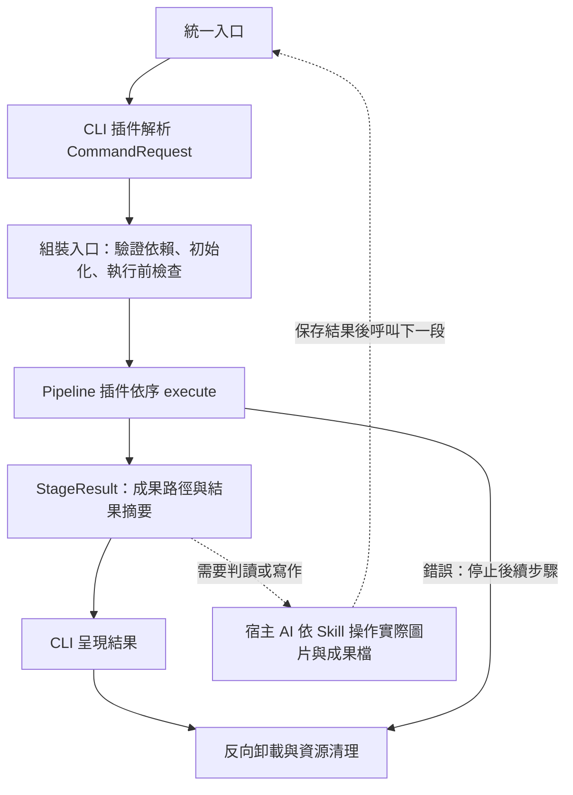

# 2.0.0 插件架構

所有正式程式操作均透過插件執行。舊業務腳本與獨立 demo 入口已移除；Dummy 僅用於測試。
最低 Python 版本為 3.10。核心及非 PDF 能力只用標準函式庫；pypdf 僅於文字擷取時載入，pypdfium2 與 Pillow 僅於渲染時載入。

## 統一入口與宿主交接

```console
python "<技能目錄>/scripts/skill.py" <command> ...
```

入口可從其他工作目錄執行；只有此可執行邊界設定模組搜尋路徑與終端編碼。
Skill 的自然語言觸發與 `-revise` 使用方式保留；後者內部呼叫 `revise PATH` 子命令。



正式管線固定如下：

| 命令 | 步驟 | 交接 |
|---|---|---|
| scan | Workspace 建立目錄 → Inventory | 宿主與使用者確認 selection |
| render | Render | 宿主看圖抽樣、建立 topics |
| prepare／packet | Prepare／Packet | 宿主逐批判讀並保存結果與 visual-review |
| finalize | Merge → Summary | 宿主依 summary 撰寫 report.md |
| report-html | Report HTML | 交付 HTML |
| revise | Workspace 定位 → Report HTML → Report Check | 回報重建結果與健檢 |

另保留 run-dir、inventory、extract、status、merge、summary、check、clean-images 單步子命令；完整管線與插件依賴對照見 [命令管線矩陣](command-pipeline-matrix.md)。
命令參數、成果檔預設及錯誤接續方式見 [操作文件](usage.md)。
不新增工作流狀態機；Python 不自動呼叫宿主 AI 或外部模型，渲染或產生工作包均不代表判讀完成。

## 分層與公開契約

- `core`：PluginManager、EventBus 與生命週期錯誤；這次遷移沒有修改核心。
- `interfaces`：Plugin、ExecutablePlugin、PluginContext、PipelineRequest，以及 CommandRequest、StageResult、Storage、ManifestReader、Statistics。
- `plugins`：各業務能力獨立資料夾；HTML 模板由 Report HTML 插件持有，SQLite 連線由 Manifest 插件管理。
- `plugins/_shared`：共用常數、純轉換／驗證、實例內生命週期輔助；沒有檔案服務、全域插件實例或服務定位器。
- `scripts/_bootstrap.py`：唯一可解析具體插件實作的組裝入口，包含明確的 factory、依賴及管線清單。

Plugin 必須有穩定的非空 id／name、init(context)、destroy()；可執行插件另外提供 execute(input)。
PluginContext 只提供 subscribe、publish、add_cleanup，不提供管理器或其他插件。
跨插件能力透過 Protocol 與建構子注入，不直接匯入其他業務插件。Report HTML 的統計補算由注入的 Statistics 提供。

CommandRequest 是具名、具型別的命令參數 dataclass；StageResult 含 request、成果路徑 artifacts 與精簡 details。
業務步驟接受 CommandRequest 或前一步 StageResult，回傳新的 StageResult；不得把全量題庫塞入 context、details 或事件。
既有 JSON 檔案 schema 不變，內部 dataclass 不寫成新的磁碟契約。
PipelineRequest 持有已初始化的步驟實例，直接傳遞輸入輸出。步驟遇錯立即停止，保留原始例外鏈與零基 step_index，顯示採一基位置。

## 註冊、執行與卸載

組裝入口先確認本命令所有依賴存在且未停用，再解析 factory、按依賴順序初始化並檢查必要套件與輸出衝突，最後執行 Pipeline。
只載入本命令的能力；例如 inventory 未指定 manifest 時不載入 SQLite Manifest，也不載入 PDF 渲染與報告能力。
`Application(disabled=frozenset({...}))` 提供程式內停用設定供測試與嵌入；不是 CLI 選項。停用必要能力會在業務寫入前失敗，無關插件不影響命令。
Application 是單次命令範圍，使用 with 確保退出時關閉。

- register 驗證欄位與方法，拒絕重複 ID，不做初始化。
- load 成功後才列為啟用；失敗時撤銷 Context、嘗試 destroy、逆序清理並移除實例。
- unload 先撤銷事件權限與訂閱，再呼叫 destroy，最後逆序執行登錄清理函式並移除實例。
- shutdown 按載入順序反向卸載；未初始化的實例不呼叫 destroy。
- 一項清理失敗不阻止其他資源回收；LifecycleError.errors 與 ShutdownError.errors 保留原始錯誤。
- 執行與關閉同時失敗時，ExecutionCleanupError 保留 primary、cleanup 及主要錯誤鏈；程序控制例外維持原例外並附 cleanup_error。

重複卸載與取消訂閱為無操作；重新載入用新實例。已撤銷 Context 拒絕發布、訂閱及新增清理。
插件匯入與建構不能開啟資源或修改程序全域設定；檔案、PDF、圖片與 SQLite 連線使用區域 with／finally，跨呼叫資源必須登錄清理或由 destroy 釋放。
單執行緒同步執行，必須等待 execute 結束才卸載；不支援熱卸載及生命週期重入。

## 通知、輸出與失敗邊界

Event Bus 同步按訂閱順序通知，payload 視為唯讀；處理器出錯仍通知其他訂閱者，publish 回傳錯誤清單。
發布期間新增的訂閱留待下次發布，取消的訂閱不再呼叫。訂閱隸屬 Context，卸載自動回收。
目前 Report HTML 發布 `report.warning`，CLI 訂閱後顯示；這是提示事件，監聽者錯誤不改變報告計算結果。

分析 JSON 保留不覆寫規則；finalize 先確認索引與統計輸出皆不存在。渲染按原設定與雜湊續跑，HTML 按原規則原子替換並同步。
Pipeline 不自動回滾成功成果，也不重試；例如索引已完成但統計失敗，使用 summary 單步接續。
來源、圖片、分類或版本變更仍依原契約失效快取；未完整核對維持 partial。

Zero-Privilege 指核心沒有業務職責，並非權限沙箱。程序內插件皆可信任；Context 只能回收其管理的訂閱與已登錄資源，無法阻止任意 Python 全域修改。

## 驗證

```console
python -m unittest discover -s tests -v
```

測試涵蓋原有分析與報告案例、插件生命週期、CLI 與管線、隔離停用、匯入無副作用、PDF 依賴延後載入、錯誤接續，以及遷移前後的索引／統計／HTML 資料與模板基準比對。
架構測試禁止核心依賴業務、插件互相匯入具體實作，並將 PDF 套件限制在相關插件函式內。
測試資料由本機合成；不讀取使用者試卷，亦不宣稱能證明宿主 AI 語意判讀正確。
